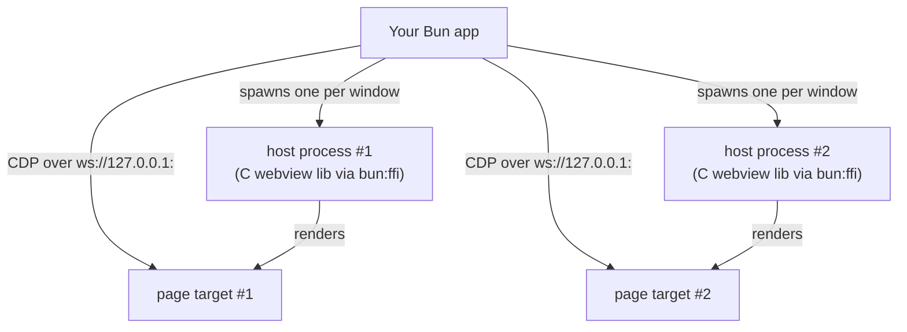

# bun-webview2

Desktop apps with Bun on Windows — native **WebView2** windows you fully control from Bun, driven over the **Chrome DevTools Protocol**.

No browser UI. No tab strip, no address bar, no Edge "App bar", no first-run nags. Your window, your icon, your process — and sub-millisecond control of the page inside it.

Zero npm runtime dependencies: the window layer is the [C `webview` library](https://github.com/webview/webview) — a single ~540 KB DLL, built once with `zig c++` (no MSVC, no cmake) and driven directly through `bun:ffi`.

## Quick start

```bash
bun add bun-webview2
```

```ts
import { createWindow } from "bun-webview2";

const win = await createWindow({
  title: "My App",
  width: 900,
  height: 600,
  html: `<h1>Hello from Bun ${Bun.version}</h1>`,
});

// Call Bun from the page
await win.expose("readFile", async (path: string) => Bun.file(path).text());
// ...then in the page: `await window.bwv2.call("readFile", "notes.txt")`

// Drive the page from Bun
await win.navigate("https://example.com");
const title = await win.evaluate<string>("document.title");

await Bun.write("shot.png", await win.screenshot());
```

Serve your frontend from Bun itself — the custom-protocol answer:

```ts
import { createWindow, serveApp } from "bun-webview2";

const served = serveApp((req) =>
  req.url.endsWith("/api/hello")
    ? Response.json({ hello: "world" })
    : new Response("<h1>My App</h1>", { headers: { "Content-Type": "text/html" } }),
);
await createWindow({ url: served.url });
```

Run it with `bun run`. Close the window (or call `win.close()`) and the process exits.

## How it works

Each window is owned by a dedicated **host process** — a tiny Bun script shipped with the library (`src/host-ffi.ts`) that creates one native window through the C webview library via `bun:ffi` and nothing else. Your process drives the page over CDP:



- **One host process per window** — buys per-window crash isolation: a dying window never takes your app down.
- **Debug port** — the library passes `--remote-debugging-port` and the data folder to each host via the WebView2 loader environment variables (`WEBVIEW2_ADDITIONAL_BROWSER_ARGUMENTS` / `WEBVIEW2_USER_DATA_FOLDER`). All windows of an app share one WebView2 browser process and one port; each window claims its own page target.
- **Everything else is CDP.** Navigation, evaluation, IPC, and screenshots flow over a loopback WebSocket using Bun's built-in client. No native module is loaded in your process.
- **Window commands ride the page.** The host's only JS runs re-entrantly inside `webview_run` — the C library's plain Win32 `GetMessage` pump, so there is no JS event loop to lose at all. Commands are CDP-evaluated as `bwv2_host_cmd(...)` in the page; the C library delivers them to the host's bind callback natively, and `webview_return` resolves the page-side promise the parent awaits — a resolved call IS the delivery confirmation. (This design came from a hard lesson: the previous wry/tao-based host's "non-blocking" pump could freeze the whole JS event loop; the C library has no loop to freeze.)
- **Events are split by layer.** Window-level events (`move`, `resize`, `focus`/`blur` via `WM_ACTIVATE`, `theme-changed`) are forwarded from the host's subclassed window procedure. Page-surface events (`key-down`/`key-up`, `mouse-*`, `scroll`, `file-drop`) are captured as DOM events by an injected bridge and forwarded over the existing CDP binding — richer than Win32 could report (layout-aware `key`/`code`, readable `File` objects on drop) and working everywhere input actually lands, including cross-origin documents.

### Why all content flows through CDP (and why windows are "primed")

wry's own initial-navigation path (`NativeWindow.loadUrl` / `loadHtml`) can stall the first page load for seconds on some machines. CDP-driven navigation against the exact same WebView2 process commits in ~30 ms. bun-webview2 therefore never touches the wry navigation path — `html` and `url` options are delivered via CDP, and you get the fast path for free. (Measured on the reference machine: cold start → loaded page ≈ 1 s; `evaluate` round-trip ≈ 0.5–1 ms.)

Related, and also handled for you: on a never-navigated webview target, CDP commands that need a renderer (`Runtime.enable`, even `Page.navigate` itself) can wedge forever. The library sends one throwaway `about:blank` navigation before any other setup, which commits a document and makes the whole protocol deterministic. Window events keep flowing across CDP-driven navigations — verified with real size changes in both wedged and healthy hosts.

## API

### `createWindow(options) → Promise<Webview2Window>`

`Webview2Window.create(...)` is identical. Resolves once the initial content has loaded.

| Option | Type | Default | Description |
|---|---|---|---|
| `title` | `string` | `"bun-webview2"` | Window title |
| `width` / `height` | `number` | `800` / `600` | Initial window size |
| `url` | `string` | — | Initial URL to load |
| `html` | `string` | — | Initial inline HTML (loaded as a `data:` URL) |
| `contextMenu` | `boolean` | `false` | Allow the native Chromium right-click menu (blocked by default) |
| `devToolsKeys` | `boolean` | `false` | Allow F12 / Ctrl+Shift+I/J/C / Ctrl+U/S/P (blocked by default) |
| `port` | `number` | auto | Fixed CDP port; all windows in a process share one port |
| `dataDir` | `string` | `%LOCALAPPDATA%\bun-webview2\<hash>` | WebView2 user-data folder (cookies, storage, cache); process-wide, first window wins |
| `navigationTimeoutSeconds` | `number` | `30` | `navigate()` timeout |

### `Webview2Window`

| Member | Description |
|---|---|
| `navigate(url)` | Navigate; resolves when the main frame's `load` event fires; rejects on failure/timeout |
| `setHTML(html)` | Replace the page with inline HTML |
| `evaluate<T>(expression)` | Evaluate an expression in the page; promises awaited; result JSON round-tripped |
| `expose(name, fn)` | Expose a Bun function to the page as `await window.bwv2.call(name, ...args)` |
| `screenshot({ format, quality })` | Capture the viewport as a PNG/JPEG `Blob` |
| `on(event, handler)` | Typed window + page events: `move`, `resize`, `focus`, `blur`, `key-down`, `key-up`, `mouse-enter`/`-leave`/`-down`/`-up`, `scroll`, `file-drop`, `theme-changed`. Window events come from the host's subclassed WndProc; page events are DOM events forwarded through the injected bridge (`file-drop` gives `File` descriptors — name/size/type — not paths). |
| | Nuances: `mouse-enter`/`-leave` fire on document-boundary crossings (the page surface); `file-drop` fires on the completed drop, not while hovering. |
| `cdp` | The live CDP connection — escape hatch to the full DevTools protocol (Network, DOM, Input, Emulation, …) |
| `url` | Current page URL (tracked across navigations, including page-initiated ones) |
| `closed` / `onClosed(cb)` / `close()` | Lifecycle |
| `setTitle`, `setSize`, `setPosition`, `setDecorations`, `setAlwaysOnTop`, `focus`, `minimize`, `maximize` | Native window controls |

### Page → Bun IPC

The library injects a bridge into every new document:

```ts
// Bun side
await win.expose("greet", async (name: string) => `hello ${name}`);
```

```js
// Page side — works in every frame, survives navigations
const greeting = await window.bwv2.call("greet", "bun");
```

Arguments and return values are JSON round-tripped; thrown errors surface as rejected promises in the page.

## Hardening

bun-webview2 windows are app windows, so they ship app-hardened by default:

- The Chromium right-click menu (Back / Save as / Print / Inspect / …) is **blocked** — `contextMenu: true` restores it.
- DevTools and browser accelerators — F12, Ctrl+Shift+I/J/C, Ctrl+U/S/P — are **blocked** via injected key handlers. `devToolsKeys: true` restores them.

Residual, documented honestly: Ctrl+Shift+I/J/C are browser-reserved accelerators in some WebView2 builds and may still open DevTools even when blocked. For a hard guarantee, set the `DeveloperToolsAvailability=2` (+ `DeveloperToolsAvailabilityAllowlist` for your origin) Edge policy on target machines — that also blocks CDP inspection of other targets, so read the [policy doc](https://learn.microsoft.com/en-us/deployedge/microsoft-edge-policies/developertoolsavailability) first.

## Requirements

- Windows 10/11 with the WebView2 runtime (preinstalled on Windows 11 and on any machine with Edge; [download link](https://developer.microsoft.com/en-us/microsoft-edge/webview2/) for the rest).
- Bun 1.2+.

macOS/Linux are not supported by this package (its window layer is WebView2-specific).

## Security notes

- The CDP port is bound to `127.0.0.1`, but **anything running on the same machine can connect to it and control your page**. This is normal for local desktop tooling and the same trade-off every CDP-driven automation tool makes. Don't build a multi-user kiosk on it.
- Hardening is UX policy, not a security boundary: the injected key/context-menu blockers prevent accidents, not a determined local user.

## Data folder and single-instance behavior

Each app gets its own WebView2 data folder (overridable with `dataDir`), so two
*different* Bun webview apps can run side by side. But one WebView2 browser
process serves one data folder: launching a **second process of the same app**
attaches it to the first process's browser, and its CDP port never appears —
window creation fails with a timeout. Treat that as a single-instance guard;
route "new window" to the running instance instead of spawning again.

## Distribution

- Each window spawns a host process. In development that's `bun` running the library's `src/host.ts`; your machine needs Bun on the PATH-compatible `process.execPath`.
- For `bun build --compile` executables, compile the host separately and point the `BWV2_HOST_EXE` environment variable at it:
  ```bash
  bun build --compile --minify src/host-ffi.ts --outfile host.exe   # inside node_modules: copy out first
  BWV2_HOST_EXE=./host.exe ./your-app.exe
  ```
- `native/webview.dll` (and the host script, unless compiled) must ship **alongside** your binary — `bun build --compile` embeds neither.
- Give the exe a custom icon with [rcedit](https://github.com/electron/rcedit); the window inherits the process icon.
- WebView2 writes its user-data folder per app; if you need to control where (e.g. Program Files installs), patch `userDataFolder` at the window layer.

## Costs, honestly

- Every window costs one Bun process (~40 MB) plus its share of the shared WebView2 browser tree. For 1–3 windows this is desktop-app normal.
- One WebView2 browser process per app means one app instance at a time (see the data-folder section above).
- The CDP debug port is a local-loopback control channel: fine for desktop apps, not for hostile multi-user machines (see security notes).

## Development

```bash
bun x tsc --noEmit      # typecheck
bun run example/verify.ts   # end-to-end verification (opens windows, needs display + network)
bun run example/quickstart.ts  # human demo
```

## License

MIT — see [LICENSE](./LICENSE).
